# Etapa V — Tema 2: Manejo de transacciones

Proyecto Farmacia Sana-Sana — Equipo 43 — Bases de Datos I (UNNE)
Motor: SQL Server Express (T-SQL)

## 1. Definición y objetivo

Una transacción es un conjunto de operaciones sobre la base de datos que se ejecutan como una sola unidad: o se confirman todas con `COMMIT`, o se deshacen todas con `ROLLBACK`. Cumple las propiedades ACID:

- **Atomicidad:** se hace todo o no se hace nada.
- **Consistencia:** la base pasa de un estado válido a otro válido.
- **Aislamiento:** las transacciones simultáneas no se pisan entre sí.
- **Durabilidad:** lo confirmado no se pierde.

El objetivo en nuestro sistema es que una venta nunca quede incompleta, por ejemplo con encabezado pero sin productos, o con el stock descontado sin venta registrada.

## 2. Ventajas y aplicaciones

- Mantiene la consistencia entre `Venta`, `Detalle_venta` y `Producto`.
- Permite deshacer todo ante un error o una compra cancelada.
- Evita vender más stock del disponible cuando dos vendedores operan a la vez.
- Se aplica a toda operación que modifica más de una tabla: registrar una venta, agregar productos a una venta y reponer stock.

## 3. Implementación en SQL Server Express

Se usan estas herramientas del motor:

- `BEGIN TRANSACTION`, `COMMIT TRANSACTION` y `ROLLBACK TRANSACTION`.
- `BEGIN TRY ... BEGIN CATCH`, para capturar errores.
- `THROW`, para lanzar errores propios y para propagar el original desde el `CATCH`.
- `SET XACT_ABORT ON`, para que ante cualquier error la transacción se revierta.
- `@@ROWCOUNT` y `@@TRANCOUNT`.

**Transacciones anidadas.** En SQL Server cada `BEGIN TRANSACTION` suma 1 a `@@TRANCOUNT` y cada `COMMIT` resta 1. Solo el `COMMIT` que lo deja en 0 confirma de verdad. Un `ROLLBACK` sin nombre deshace todo, sin importar el nivel. Por eso los procedimientos de abajo, que tienen su propia transacción, se pueden llamar dentro de otra transacción mayor, que decide el resultado final.

Script completo: [`sql/tecnico/transacciones/transacciones.sql`](../../../sql/tecnico/transacciones/transacciones.sql)

Define dos procedimientos:

- **`sp_RegistrarVentaCompleta`:** registra la venta de un producto. Valida los parámetros (fecha, cantidad, precio, venta repetida, cliente y vendedor existentes). Inserta el encabezado, descuenta el stock y inserta el detalle, todo en una transacción.
- **`sp_AgregarProductoAVenta`:** agrega más productos a una venta ya registrada. Calcula el número de línea con `MAX + 1`, protegido con `UPDLOCK, HOLDLOCK`.

Decisiones de diseño:

- El stock se descuenta con un `UPDATE` condicionado (`WHERE stock >= @cantidad`). Si no afecta filas (`@@ROWCOUNT = 0`), el producto no existe o no alcanza el stock, y se lanza el error 50026. Esto evita también el problema de concurrencia.
- El precio se guarda en `Detalle_venta` como precio histórico.
- El `CATCH` hace `ROLLBACK` si queda una transacción abierta y vuelve a lanzar el error con `THROW`.

## 4. Caso concreto en el sistema de ventas

Un vendedor registra la venta de 3 cajas de Paracetamol 500 mg. La operación inserta la venta, inserta su línea y descuenta 3 unidades de stock. Si el producto no existe o el stock no alcanza, no debe quedar nada registrado.

## 5. Demostración y resultados

Script de pruebas: [`sql/tecnico/transacciones/demostracion_transacciones.sql`](../../../sql/tecnico/transacciones/demostracion_transacciones.sql). Requiere `00_crear_bd_corregido.sql`, `LoteCarga_Farmacia.sql` y la implementación de los Temas 1 y 2 (usa `fn_CalcularSubtotal`).

### Prueba 1 — Venta correcta
Venta 200, producto 2, cantidad 3. Resultado esperado: queda la venta con su línea 1 y el stock baja de 98 a 95.

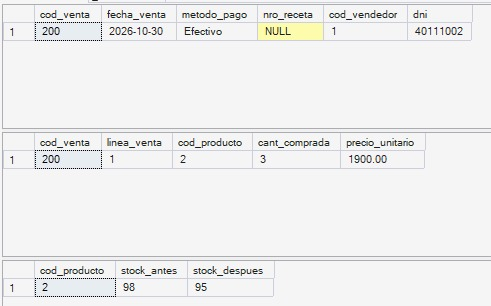

### Prueba 2 — Stock insuficiente
Producto 6, cantidad 9999. Resultado esperado: error 50026; no queda venta, detalle ni cambio de stock.

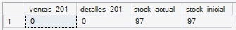
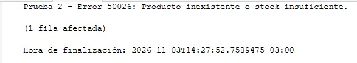

### Prueba 3 — Producto inexistente
Producto 999. Resultado esperado: error 50026; no queda nada registrado.

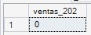
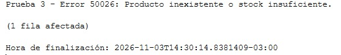

### Prueba 4 — Validaciones de parámetros
Fecha futura (50020), cliente inexistente (50024), venta repetida (50023) y método de pago inválido (error 547 de la restricción de la tabla). No queda nada registrado.

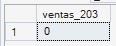
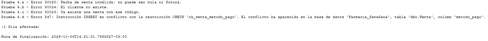

### Prueba 5 — Venta con varios productos
La venta 200 queda con tres líneas. La llamada que pide 9999 unidades falla con el error 50026 y solo se deshace esa línea.

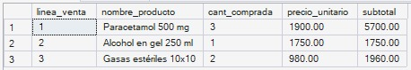
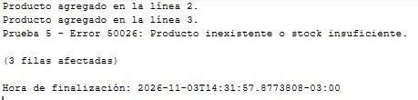

### Prueba 6 — Contraejemplo sin transacción
Los mismos pasos sin transacción: el error de stock llega tarde y la venta 204 queda grabada sin detalle.

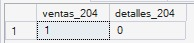
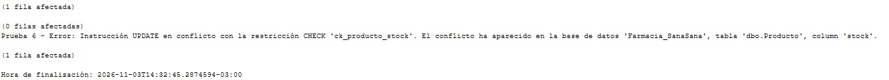

## 6. Conclusiones

1. La transacción garantiza atomicidad: ante cualquier error se deshace todo, incluso el encabezado ya insertado (pruebas 2 y 3).
2. El `UPDATE` condicionado resuelve producto inexistente y stock insuficiente con una sola verificación.
3. Las validaciones previas dan mensajes claros, y los errores de las restricciones de la tabla se propagan con `THROW` (prueba 4).
4. Sin transacción, un error a mitad del proceso deja datos inconsistentes (prueba 6). Por eso toda operación de varias tablas se ejecuta dentro de una transacción.
5. Al ejecutar los scripts en SQL Server Express, los resultados coincidieron con los esperados en todas las pruebas. Al terminar se ejecutó la limpieza del script para dejar la base como al inicio.
